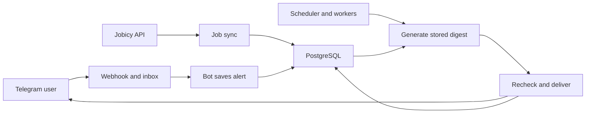

# Worked example: one daily job digest

## Project in one sentence

[Remote Job Radar][readme] helps Telegram users discover remote roles and receive daily matches from Jobicy.

This brief was generated using `project-quickstart` by a separate agent through static inspection. Source: **gelatoni-xh/telegram-job-alerts**, pinned to **66c8791b6e10dfeede04e49995b332902c4507c7**. The full application exceeds a tiny Hello World; this walkthrough follows **one saved alert → one daily digest**. Administration, privacy, backups and deployment internals are outside scope.

## How to run or inspect

Start with [README.en.md][readme] and [operations.md][ops]. They specify Node.js 24, pnpm 10.32.1 and isolated PostgreSQL 17. The documented setup uses `pnpm install --frozen-lockfile`, `pnpm db:generate`, local Docker Compose, database environment variables, then `pnpm db:migrate`, `pnpm typecheck`, `pnpm test`, `pnpm build` and `pnpm dev`.

Commands are **not executed here**. Integration tests truncate tables and require `TEST_DATABASE_URL` ending in `_test`. [`.env.example`][env] disables source sync, scheduling and delivery by default; a real bot additionally needs credentials and webhook configuration.

## Architecture map

[`src/main.ts`][main] starts the HTTP server, workers and scheduler in one process. [`http.ts`][http] authenticates Telegram webhooks and persists inbox work; [`bot.ts`][bot] handles conversations. [`jobs.ts`][jobs] imports and matches listings, [`subscriptions.ts`][subs] saves alert boundaries, and [`digests.ts`][digests] generates and delivers digests. [`tasks.ts`][tasks] stores retriable work in PostgreSQL. [`schema.prisma`][schema] defines users, subscriptions, jobs, tasks, digest membership and delivery state.

## Main feature and data flow

1. The user saves filters and confirms a timezone/send time. Subscription creation records the committed discovery boundary: existing inventory remains searchable but does not become a new-alert backlog.
2. Source sync validates Jobicy pages and upserts jobs by source ID. Newly discovered jobs receive increasing discovery numbers.
3. The scheduler queues due users. Digest generation selects matching jobs after each subscription’s boundary, combines overlapping matches, stores membership, and advances boundaries. Unknown or stale candidates are deferred.
4. Delivery merges outstanding days, rechecks stale job statuses and current subscription revisions, then sends a preview with a button for stored digest pages. Empty results produce no notification. Delivery state records success, retry or uncertainty.

## Tech stack

[The manifest][manifest] confirms TypeScript, grammY, Fastify, Prisma and PostgreSQL tooling. Their inspected roles are Telegram interactions, HTTP ingress and persisted state. Luxon handles local scheduling; Zod validates configuration and source responses.

## Evidence map

| Claim | Pinned evidence | Confidence |
|---|---|---|
| Existing inventory is excluded from new alerts | [Subscriptions][subs], [integration assertions][integration] | High, static |
| One digest record per user/local date | [Schema constraint][schema], [generation][digests] | High, static |
| DST gaps/overlaps have explicit rules | [Rules][rules], [unit assertions][unit] | High, static |
| Lost send responses can duplicate notifications | [Delivery implementation][digests], [operations caveat][ops] | High, static |

## Strengths, risks and improvements

**Strengths:** durable membership, unique constraints and subscription revisions make recovery understandable; tests cover boundaries, overlapping alerts and delivery failures.

**Risks:** Telegram delivery cannot guarantee exactly once; geography parsing intentionally misses ambiguous eligibility. One runtime instance is enforced through a database lock, limiting horizontal scaling.

**Improvement:** document a fixture walkthrough reproducing save → discover → generate → simulated send, for safe newcomer exploration.

## What to study first

Read [main.ts][main] → [schema.prisma][schema] → [subscriptions.ts][subs] → [digests.ts][digests] → [integration.test.ts][integration]. Trace one new job across the saved boundary and explain which rows survive a restart.

## Verification status and uncertainties

Inspected: skill/rubric/template, source AGENTS.md, README, manifest/configuration, entry point, linked modules/models, selected tests and Git history. Ran searches, Git SHA/log checks and the Python 3 snapshot. No installs, app runtime, tests, typecheck/build, services or Telegram sends ran. Live API compatibility and actual delivery remain unverified; isolated checks and a controlled end-to-end run would confirm them. No source code is reproduced here; the README notes no declared open-source license.

[readme]: https://github.com/gelatoni-xh/telegram-job-alerts/blob/66c8791b6e10dfeede04e49995b332902c4507c7/README.en.md
[ops]: https://github.com/gelatoni-xh/telegram-job-alerts/blob/66c8791b6e10dfeede04e49995b332902c4507c7/docs/operations.md
[env]: https://github.com/gelatoni-xh/telegram-job-alerts/blob/66c8791b6e10dfeede04e49995b332902c4507c7/.env.example
[main]: https://github.com/gelatoni-xh/telegram-job-alerts/blob/66c8791b6e10dfeede04e49995b332902c4507c7/src/main.ts
[http]: https://github.com/gelatoni-xh/telegram-job-alerts/blob/66c8791b6e10dfeede04e49995b332902c4507c7/src/http.ts
[bot]: https://github.com/gelatoni-xh/telegram-job-alerts/blob/66c8791b6e10dfeede04e49995b332902c4507c7/src/bot.ts
[jobs]: https://github.com/gelatoni-xh/telegram-job-alerts/blob/66c8791b6e10dfeede04e49995b332902c4507c7/src/jobs.ts
[subs]: https://github.com/gelatoni-xh/telegram-job-alerts/blob/66c8791b6e10dfeede04e49995b332902c4507c7/src/subscriptions.ts
[digests]: https://github.com/gelatoni-xh/telegram-job-alerts/blob/66c8791b6e10dfeede04e49995b332902c4507c7/src/digests.ts
[tasks]: https://github.com/gelatoni-xh/telegram-job-alerts/blob/66c8791b6e10dfeede04e49995b332902c4507c7/src/tasks.ts
[schema]: https://github.com/gelatoni-xh/telegram-job-alerts/blob/66c8791b6e10dfeede04e49995b332902c4507c7/prisma/schema.prisma
[manifest]: https://github.com/gelatoni-xh/telegram-job-alerts/blob/66c8791b6e10dfeede04e49995b332902c4507c7/package.json
[integration]: https://github.com/gelatoni-xh/telegram-job-alerts/blob/66c8791b6e10dfeede04e49995b332902c4507c7/tests/integration.test.ts
[rules]: https://github.com/gelatoni-xh/telegram-job-alerts/blob/66c8791b6e10dfeede04e49995b332902c4507c7/src/rules.ts
[unit]: https://github.com/gelatoni-xh/telegram-job-alerts/blob/66c8791b6e10dfeede04e49995b332902c4507c7/tests/rules.test.ts
