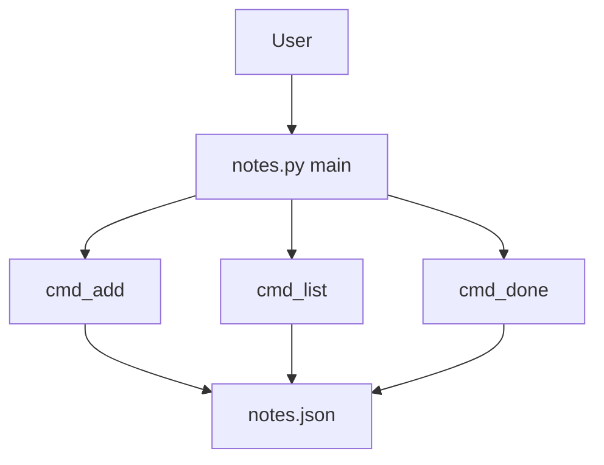

# Worked example: tiny notes CLI

This is one end-to-end pass of `$project-quickstart`: a short request, then a project brief in the shape of [`project-quickstart/assets/project-brief-template.md`](../project-quickstart/assets/project-brief-template.md).

The subject is the teaching fixture [`examples/tiny-notes-cli`](tiny-notes-cli/) in this repository. It is a small local CLI written for this example, not a third-party product. Claims below point at those files. Commands that were actually run are listed under Verification Status.

A live agent should produce the same sections. Wording will differ. The bar is the rubric in [`project-quickstart/references/output-rubric.md`](../project-quickstart/references/output-rubric.md): evidence, a diagram, honest limits, and ownership-safe interview language.

## The request

```text
Use $project-quickstart on examples/tiny-notes-cli.
I want an interview-ready project brief. I am studying this small CLI; I did not design it as a production app.
```

## One-Sentence Summary

`tiny-notes-cli` is a standard-library Python program that stores a personal note list in a local JSON file so a reader can trace one command-line tool from argument parsing to disk.

## How To Run Or Inspect

- Requirements: Python 3.9+ (this pass used Python 3.12). No third-party packages.
- Main commands, from `examples/tiny-notes-cli` (also written in that folder's README):

```bash
python notes.py add "buy milk"
python notes.py list
python notes.py done 1
python -m unittest test_notes.py
```

- Optional structural scan from the repository root:

```bash
python project-quickstart/scripts/repo_snapshot.py examples/tiny-notes-cli
```

- Important environment variables: none. The only path override is `--file`.

## Architecture Map

- Entry point: `examples/tiny-notes-cli/notes.py` (`main`, guarded by `if __name__ == "__main__"`).
- Frontend/UI: the terminal. `argparse` defines `add`, `list`, and `done`.
- Backend/API: three functions in the same file, `cmd_add`, `cmd_list`, and `cmd_done`.
- Data model/storage: a JSON array of objects with `id`, `text`, and `done`. Default path is `notes.json` beside the script.
- Tests: `examples/tiny-notes-cli/test_notes.py` (stdlib `unittest`). Each test passes `--file` pointing at a temp directory.
- Configuration/deployment: none. No manifest, no network, no service.



## Main Flow

`add` is the clearest path. `main` parses `--file` and the `add` subcommand, then `cmd_add` reads the JSON file (or starts from an empty list when the file is missing), assigns `max(id) + 1`, appends `{"id", "text", "done": false}`, and writes the array back with `json.dumps`. The process prints `added #<id>`.

`list` prints `no notes` when the array is empty, otherwise one line per note: `1. [ ] buy milk` or `1. [x] buy milk` when `done` is true. `done <id>` sets that flag and prints `done #<id>`. An unknown id prints `no note #<id>` on stderr and returns exit code 1.

## Tech Stack

- Languages: Python.
- Frameworks: none. Argument parsing is `argparse`; tests are `unittest`.
- Database/storage: one JSON file, chosen so the fixture has no setup step.
- Tooling: the optional `repo_snapshot.py` helper in the skill. It is a map, not the source of truth (see the evidence map).

## Evidence Map

| Claim | Evidence | Confidence |
| --- | --- | --- |
| The program adds, lists, and completes notes from the terminal | `add` / `list` / `done` in `notes.py`; run block in `examples/tiny-notes-cli/README.md` | inspected, and the three commands were run |
| Notes are a JSON array of `id`, `text`, and `done` | `cmd_add` and `save_notes` in `notes.py`; the demo wrote that shape to a temp file | inspected and ran |
| A missing file is treated as an empty list | `load_notes` returns `[]` when the path does not exist; `test_empty_list` | inspected and ran |
| An unknown id fails with exit code 1 | `cmd_done` writes to stderr and returns 1; `test_missing_id_exits_nonzero` | inspected and ran |
| There is no network and no third-party dependency | imports in `notes.py` are `argparse`, `json`, `sys`, and `pathlib` | inspected |
| The snapshot helper does not name `notes.py` as an entry point | `python project-quickstart/scripts/repo_snapshot.py examples/tiny-notes-cli` listed `README.md` and `test_notes.py`, and "Likely Entry Points" was empty. `ENTRYPOINT_HINTS` in `project-quickstart/scripts/repo_snapshot.py` has names like `main.py` and `app.py`, not `notes.py` | ran and inspected |

## Strengths, Risks, And Improvements

Strengths:

- The behavior sits in one module, so a new reader can follow a command without a framework tour.
- Tests call the real script with `--file`, so they do not write the fixture's default `notes.json`.
- Failure for a missing id is visible: stderr text plus a non-zero exit code.

Risks:

- `load_notes` calls `json.loads` directly. A corrupt `notes.json` raises `JSONDecodeError` with a traceback. That path was not executed in this pass.
- Two processes can write the same file. Nothing locks it.
- `repo_snapshot.py` will under-report the entry point for this layout. A brief that copied the snapshot and stopped would miss `notes.py`.

Improvement opportunities:

- Catch invalid JSON and print a one-line error.
- Add a delete command only if ids stay unique. Today there is no delete, and ids are `max(id) + 1`.

## Interview Pitch

Say that you studied this fixture. Do not describe it as a production notes product you shipped.

30-second version:

This is a local notes CLI I read in order to practice walking through a small repo. You can add a note, list notes, and mark one done. The data is a JSON file next to the script. I can trace that path in `notes.py`.

1-minute version:

The entry point is `main` in `notes.py`. `argparse` picks `cmd_add`, `cmd_list`, or `cmd_done`. Persistence is load-then-save of a JSON array, not a database. The tests shell out to the script with a temporary `--file`. One thing I would mention as a review comment: the skill's snapshot script does not classify `notes.py` as an entry point, so the README and the `main` guard are the evidence, not the snapshot.

3-minute version:

I would walk the `add` path, then the failure path for `done` with a bad id. The design tradeoff is setup versus safety: a JSON file needs no install, and it has no concurrency story and no friendly parse error. I did not run a corrupt-file case; I only read `json.loads`. If I were extending it, the first patch would be a clear error for invalid JSON, with a test. I would still introduce it as something I studied, not something I operated for users.

Technical highlights:

- Subcommands and exit codes in one file.
- Tests that exercise the CLI boundary instead of only calling helpers.
- A concrete case where a structural scan and the source disagree, and the source wins.

Tradeoffs and improvements:

- JSON keeps the example runnable with the standard library. SQLite would be a different project.
- The snapshot helper is useful on larger repos and incomplete on this one. That is a reason to open the files.

Likely questions:

1. Where does execution start? `main` at the bottom of `notes.py`.
2. What happens if `notes.json` is missing? `load_notes` returns an empty list.
3. How is the next id chosen? One more than the current maximum, or 1 when the list is empty.
4. How does a bad id fail? `no note #<id>` on stderr and exit code 1.
5. Why do the tests pass `--file`? So the default `notes.json` beside the script stays untouched.
6. What did you not run? A corrupt JSON file, two writers at once, and Windows.

## Reading Plan

1. `examples/tiny-notes-cli/README.md` for the commands the project claims.
2. `notes.py`: `main`, then `cmd_add`, `cmd_list`, `cmd_done`, then `load_notes` / `save_notes`.
3. `test_notes.py` to see which of those paths have tests.
4. `project-quickstart/references/output-rubric.md` if you want to redo this brief in your own words.

## Uncertainties

- Commands were run with Python 3.12 on Linux. Windows PowerShell was not used.
- Invalid JSON and concurrent writes are inferred from the code. They were not executed.
- The snapshot also prints the git branch of the parent checkout. That metadata describes this skill repository, not a separate history for the fixture.

## Verification Status

- Commands run:
  - `python -m unittest test_notes.py` in `examples/tiny-notes-cli` (3 tests, OK).
  - `python notes.py --file <temp>/notes.json add "buy milk"`, a second `add`, `list`, `done 1`, `list`, and `done 9`. The last command printed `no note #9` and exited 1. The temp file contained two objects; id 1 had `"done": true`.
  - `python project-quickstart/scripts/repo_snapshot.py examples/tiny-notes-cli` from the repo root (4 files sampled, no likely entry point reported).
- Tests run: the unittest module above. No other test runner is configured.
- Not run: corrupt JSON, two writers, Windows, any install step (there is nothing to install).
- Why not: those gaps are visible from the source, and marking them as executed would overclaim. Static reading is enough to name them as risks.
